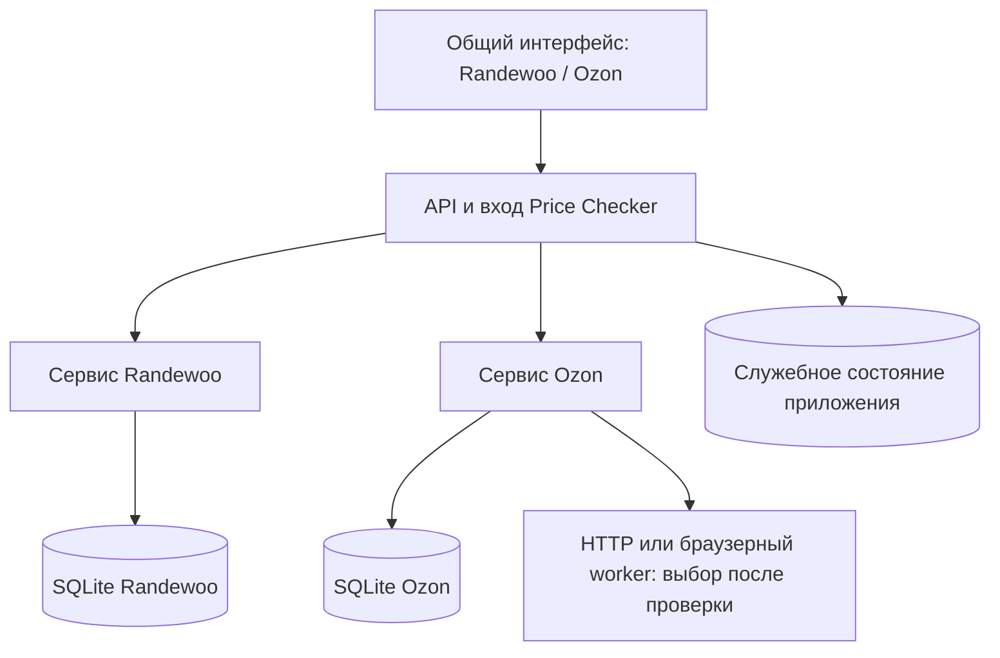

# Поддержка Ozon в Price Checker

Дата: 17 октября 2026, обновлено 18 октября. Статус: архитектурный проект и первый этап реализации; на VDS подтверждены браузерные и HTTP-чтения, длительное расписание ещё не проверено. Дальнейшие проверки приостановлены по решению владельца. Фактические результаты: [ozon-feasibility.md](ozon-feasibility.md).
Worktree: `price-checker-ozon-design`. Ветка: `design/ozon-support`, исходный commit: `661d23f`.

## Подтверждённые требования

- Поддерживать любые категории товаров Ozon, добавление по ссылке.
- Уже в первой версии читать корзину и избранное аккаунта Ozon.
- Сбор должен работать круглосуточно на текущем сервере без компьютера владельца.
- Предпочтительно показывать обе цены: обычную и по Ozon Карте. Если надёжно доступна только одна, приоритет — цена по Ozon Карте.
- Данные Ozon и Randewoo хранятся в физически отдельных базах, с независимыми миграциями и резервными копиями.
- Наблюдение за товаром продолжается при подтверждённой смене продавца; смена видна в интерфейсе и истории.
- Из аккаунтных подборок кроме корзины требуется обычное избранное; именованные вишлисты в первую версию не входят.
- Сохранять историю цен, показывать графики, изменения и результаты проверок.
- Начальный объём уточнён: последние 30 настоящих товаров обычного избранного в порядке «Новые»; корзина синхронизируется отдельно. Недоступные товары сохраняются, вставки «Нашли похожий/такой же» не включаются. Возможность роста до 50–100 сохраняется.
- Подтверждённый интервал полного прохода Ozon — каждые 2 часа; ограничения доступа и обязательные паузы имеют приоритет над расписанием.
- Город доставки — Грозный. Выбранный адрес или пункт выдачи получаем из аккаунта Ozon после подключения; возможность чтения нужного контекста проверяется техническим экспериментом.
- Пользователь разрешил начать реализацию в отдельном worktree. Сначала проверяется осуществимость обязательных сценариев; перенос хранения и новый интерфейс следуют после подтверждения серверного транспорта.

Предлагаемые границы первой версии: один владелец приложения и один аккаунт Ozon. Контекст доставки уже определён пользователем: Грозный, адрес из подключённого аккаунта. Корзина и избранное синхронизируются в направлении Ozon → Price Checker. Запись в аккаунт Ozon, покупка и применение купонов в первую версию не входят.

## Архитектурное решение

Рекомендация: один репозиторий, одно приложение, отдельный раздел Ozon и отдельный сервис источника со своей БД. Интерфейс, вход в Price Checker, компоненты графиков и общие алгоритмы остаются общими. История, списки, настройки, задания и результаты проверок хранятся отдельно у каждого магазина. Авторизация в магазинах, получение данных, правила разбора и синхронизация списков принадлежат конкретному адаптеру. Подробные границы хранения и эксплуатации определены в [ozon-storage-design.md](ozon-storage-design.md).

| Вариант | Преимущества | Стоимость и ограничения | Вывод |
| --- | --- | --- | --- |
| Отдельный проект Ozon | Полная независимость кода и выпусков | Дублирование интерфейса, истории, входа, тестов и деплоя; исправления придётся переносить | Оправдан для отдельного продукта или команды |
| Новый route поверх текущего Tracker | Небольшое первое изменение | Сохраняет зависимости от Randewoo; проверки, списки и цены могут смешаться | Недостаточно для требуемого функционала |
| Отдельный раздел и адаптер в текущем приложении | Повторное использование общих функций при разделении источников | Потребуется аккуратно выделить границы и расширить модель данных | Рекомендуется |

Если для Ozon потребуется отдельный браузерный процесс на сервере, его можно выделить в worker внутри этого же проекта. Способ исполнения сборщика не определяет число приложений и репозиториев. Локальный агент на компьютере владельца не соответствует подтверждённому требованию круглосуточной серверной работы.

## Что обнаружено в текущем коде

| Участок | Текущая связь с Randewoo | Требуемое изменение |
| --- | --- | --- |
| `src/client.js` | URL только randewoo.ru, фильтр 1,5 мл, собственные парсеры корзины и избранного | Оставить эти правила в адаптере Randewoo; Ozon реализовать отдельно |
| `src/service.js` | Tracker создаёт Randewoo и RandewooLogin; один `running`, расписание и цикл проверки | Выделить сервис источника и независимые задания по магазинам |
| `src/database.js` | Схема Randewoo, default 1,5 мл, одни списки и settings | Закрепить за Randewoo; создать отдельное хранилище Ozon с нужными ему сущностями |
| `frontend/src/router.tsx` | Один параметр списка, только четыре списка | Добавить пространство маршрутов магазина |
| `frontend/src/lib/types.ts` | Цена только `public` или `cart`; нет продавца и типа оплаты | Разделить место получения цены и условия её действия |
| `frontend/src/lib/api.ts` | Ключи кеша без магазина | Включить источник и контекст во все ключи |
| `src/web.js` | API и список SPA-маршрутов без магазина; CSP картинок только Randewoo | Добавить API источников, SPA-маршруты и проверенные домены изображений |
| `src/telegram.js`, `run.js` | Один Tracker; глобальный Telegram cursor и диалоги находятся в его БД | Реестр независимых сервисов; глобальное состояние Telegram вынести в служебное хранилище |
| `scripts/deploy.py` | Перед выпуском копируется только `data/prices.sqlite3` | Поимённый backup каждой БД, проверка типа и независимое восстановление |
| `start.ps1` | Адрес и health-check привязаны к порту 8000 | Для параллельной разработки использовать отдельный порт и данные |

Одна замена домена или добавление `/ozon` не обеспечат корректную работу. Общие компоненты таблицы и графиков можно переиспользовать после устранения предположений о пробниках и двух фиксированных контекстах цены.

## Главная неопределённость: подключение аккаунта

До переработки приложения нужен технический эксперимент с настоящим аккаунтом и репрезентативными карточками. Корзина и избранное входят в обязательный объём первой версии, поэтому успех только на публичной карточке недостаточен.

Seller API не считаем подтверждённым решением для покупательской корзины и избранного. Найденные официальные материалы описывают работу с товарами продавца, но доступный API для наших покупательских сценариев в рамках этого исследования не подтверждён. Конкретные методы и способы авторизации нельзя закладывать как готовые.

Порядок выбора транспорта:

1. Проверить наличие официального интерфейса с нужными покупательскими возможностями.
2. Если его нет, проверить чтение данных через отдельную авторизованную браузерную сессию Ozon. Переиспользовать данные штатной страницы можно только после проверки их структуры и полноты.
3. Проверить, работает ли тот же подход на сервере Ubuntu после перезапуска и без постоянно открытого пользовательского браузера.
4. Если серверный вариант нестабилен, зафиксировать блокирующее ограничение и искать другой серверный способ подключения/получения данных. Внешний сервис допустимо оценить как отдельный вариант с проверкой доступа к корзине/избранному, условий хранения сессии и стоимости; не предполагать его доступность заранее.

Серверный сбор — обязательное условие готовности. Локальный сбор не является запасным решением в текущем объёме требований. Ручное подтверждение входа при подключении или истечении сессии может потребоваться; круглосуточная работа не означает обещание бессрочной сессии Ozon.

Сессии Ozon и Randewoo разделены. Вход, требующий кода или другого подтверждения, проходит с участием владельца. Состояния подключения: `disconnected`, `connecting`, `connected`, `expired`, `action_required`, `error`. Истёкшая сессия не означает пустые списки. Автоматически повторять попытки входа бесконечно нельзя.

При браузерном варианте использовать выделенный серверный профиль Ozon вне Git. Сессионные данные и коды не попадают в логи, JSON API или browser storage приложения. Для подключения из интерфейса приложения нужно защищённое временное взаимодействие с серверным worker: вход доступен только владельцу, с ограниченным сроком и закрытием после подтверждения. Механизм передачи кода или интерактивного подтверждения определяется после эксперимента. Перенос cookie с компьютера на сервер не считать заранее работающим способом.

## Поведение интерфейса

В боковой панели появляется переключатель `Randewoo / Ozon`.

- Randewoo сохраняет существующие возможности.
- Ozon получает вкладки «Корзина Ozon», «Избранное», «Наблюдение» и локальную «Мою корзину».
- Корзина Ozon показывает состав аккаунта, количество и факт последней успешной синхронизации.
- «Моя корзина» — локальная подборка, без отправки изменений в Ozon; для первой версии её можно переиспользовать из текущего приложения.
- Форма добавления определяет магазин по ссылке и предлагает добавить конкретный вариант в наблюдение. Повторное добавление не создаёт дубль.
- В Ozon нет фильтра 1,5 мл. Размер, цвет, объём и комплектность отображаются как характеристики варианта, если доступны.
- У товара видны продавец, тип цены, контекст доставки, время цены и результат последней проверки.
- Подтверждённая смена продавца не прекращает наблюдение: новая цена отображается вместе с событием смены предложения. Дата события означает момент обнаружения проверкой.
- В таблице Ozon показываются обе цены отдельными колонками, если доступны. Если доступна только цена по Ozon Карте, обычная цена отмечается как неизвестная; график позволяет выбрать отдельный ряд, по умолчанию — Ozon Карта.
- Настройки подключения и расписания отдельные для каждого магазина. Кнопка «Проверить» действует на открытый магазин.

Предлагаемые маршруты: `/randewoo/cart`, `/randewoo/favorites`, `/randewoo/watching`, `/randewoo/my-cart` и аналогичные `/ozon/...`. Старые `/cart`, `/favorites`, `/watching`, `/my-cart` перенаправляются в Randewoo с сохранением поисковых параметров. `/` сохраняет текущую стартовую страницу Randewoo; запоминание последнего магазина можно добавить отдельно. Перезагрузка и прямое открытие работают для всех новых маршрутов.

## Доставка: Грозный и адрес аккаунта

После подключения читаем текущий выбранный контекст доставки аккаунта: город, адрес или пункт выдачи и доступный идентификатор контекста. Для проверки цен используем подтверждённый контекст Грозного. При нескольких сохранённых адресах берём выбранный для покупок, если он относится к Грозному; неоднозначность уточняется при настройке подключения.

В текущем локальном аккаунте владелец выбрал нужный пункт выдачи в Грозном; Ozon показывает для него метку «п. Алды». Сравнения только с буквальной строкой «Грозный» недостаточно. Полный адрес остаётся в приватном контексте, серверное воспроизведение выбора ещё требуется проверить.

Если выбран другой город или контекст прочитать не удалось, показываем несовпадение/неподтверждённую доставку. Данные из неизвестного региона нельзя сохранять как цены для Грозного. История и состав списков сохраняются, ценовые задания для неподтверждённого контекста приостанавливаются до его выбора или восстановления. Автоматически менять адрес в аккаунте приложение не должно.

В интерфейсе достаточно показывать город и понятную метку выбранного контекста. В истории наблюдений храним город и локальную ссылку на контекст, без полного почтового адреса; необходимые приватные данные подключения остаются у адаптера Ozon. Подтверждённая смена адреса/пункта выдачи создаёт отдельный контекст даже внутри Грозного, чтобы не смешивать наблюдения с разными условиями доставки. Получение текущего адреса, проверка города и воспроизводимость контекста после перезапуска входят в технический эксперимент.

## Что именно считается ценой

У одного наблюдения должны быть явно заданы:

- магазин, товар и выбранный вариант;
- конкретное предложение и продавец, когда их можно определить;
- регион или контекст доставки, фактически использованный источником;
- аккаунт или публичная сессия;
- место получения: карточка либо корзина;
- тип цены: обычная, по Ozon Карте, иные явно распознанные условия;
- количество и применимые условия заказа, если цена зависит от них;
- валюта, наличие и время проверки.

По подтверждённому требованию собираем обе цены, когда они однозначно доступны; при невозможности получить обе приоритет — достоверная цена по Ozon Карте. Если не удаётся подтвердить именно её, это ограничение результата, а не повод молча подменить её обычной. Неизвестный тип цены нельзя подписывать как обычный или карточный. Персональные купоны, баллы, доставка и итог заказа не выводятся из цены карточки арифметически. Если из корзины получена только сумма строки, сохраняем сумму и количество с соответствующей меткой, не объявляем результат деления безусловной ценой единицы.

Официальные материалы подтверждают скидку при оплате Ozon Картой и региональные/товарные условия купонов. Влияние остальных параметров на конкретные поля ответов необходимо проверить экспериментом. Часовой пояс расписания `Europe/Moscow` не определяет регион доставки.

Отслеживаем выбранный товар и вариант, продолжая наблюдение при подтверждённой смене продавца текущего предложения карточки. Товар наблюдения и предложения продавцов — разные сущности: смена предложения создаёт событие, а не новый товар наблюдения. В таблице видны предыдущий и текущий продавцы, новая цена и изменение относительно последнего сопоставимого контекста с пометкой «другой продавец». История исходного предложения сохраняется. Режим «самое дешёвое предложение среди всех продавцов» не включён: он требует отдельного обхода предложений и правил выбора.

График товара сохраняет хронологию, но делится на участки по предложению продавца с отметками переходов. Скидки и рост внутри предложения рассчитываются при одинаковых продавце, контексте доставки/аккаунта, канале, типе цены и условиях количества. Переход к другому продавцу — отдельный тип изменения; его нельзя назвать скидкой исходного продавца. Минимум у продавца и минимум по товару среди наблюдавшихся предложений обозначаются раздельно. Смена региона/аккаунта/типа цены начинает другой контекст. Корзина с меняющимся составом сохраняет состав снимка, а изменение состава отображается отдельно от изменения цен.

Продолжение наблюдения не означает автоматическую покупку или замену позиции в корзине Ozon. Корзина отражает фактический состав аккаунта; замена определяется только полученным полным снимком. При отсутствии подтверждённой связи нового предложения с тем же вариантом не подбираем замену по названию: сохраняем цель наблюдения, показываем состояние и продолжаем проверки. Неизвестный ID продавца не является доказательством смены. Подробные примеры — в [проекте хранения](ozon-storage-design.md#наблюдение-при-смене-продавца).

## Модель данных и совместимость

Использовать две физически отдельные SQLite. Для первой поставки оставить Randewoo по текущему пути `.data/prices.sqlite3`, новую Ozon создать в `.data/ozon/prices.sqlite3`. Перемещение Randewoo в `.data/randewoo/prices.sqlite3` возможно позже отдельной операцией и не является условием интеграции Ozon. Общее техническое состояние Telegram/диалогов переносится в `.data/app/state.sqlite3`, без таблиц товаров, цен, списков и наблюдений магазинов. Схемы и миграции двух магазинов независимы; Ozon не требует преобразовать Randewoo в универсальный маркетплейс. Ниже — логические сущности Ozon; окончательный SQL определяется после проверки его идентификаторов.

| Сущность | Назначение и ограничения |
| --- | --- |
| Метаданные БД | Владелец `ozon` и версия схемы; открытие через сервис другого магазина отклоняется |
| Товар / вариант | ID локальны внутри базы Ozon; внешний ID привязан к семантике источника; URL — атрибут, не единственный ключ |
| Цель наблюдения | Выбранный товар/вариант и политика следования текущему предложению; не меняет ID при смене продавца |
| Предложение | Вариант + продавец + внешний ID предложения, если доступен; устойчивость ключа проверяется экспериментом |
| Контекст наблюдения | Аккаунт/публичный режим, доставка, канал, тип цены, условия количества; без cookie и полного адреса |
| Список / членство | Аккаунт и локальные ID Ozon; отдельные корзина, избранное, наблюдение и локальная подборка; количество сохраняется |
| Проверка | Триггер, прогресс, результат и время только Ozon; синхронизация каждого списка имеет отдельный результат |
| Наблюдение | Предложение, контекст, цена в целых минимальных единицах валюты, наличие, время, статус; наблюдения не перезаписываются |
| Событие цели | Смена предложения/продавца с предыдущими и новыми локальными ссылками и временем обнаружения |
| Снимок списка | Состав, количества, время и признак полноты; нужен для корректного итога корзины и обработки частичных ответов |

Путь миграции: согласованно сохранить текущую БД Randewoo и сохранить её действующий путь, ID/связи/времена/цены; отдельно вынести общие служебные таблицы Telegram. Базу Ozon создать заново по собственной схеме. Старые `public/cart` и правило 1,5 мл остаются в Randewoo; преобразование его исторических цен для Ozon не требуется. Старые API остаются фасадом только над Randewoo. Метаданные типа БД и проверка канонических путей предотвращают случайное открытие одного файла двумя сервисами. Установка Ozon не импортирует историю Randewoo.

Не объединять автоматически один товар между Ozon и Randewoo по названию. Межмагазинное сравнение — отдельная будущая функция с явным сопоставлением вариантов.

## Контракт адаптеров и API

Минимальные операции адаптера: нормализация URL, описание поддерживаемых возможностей, состояние подключения, запуск/завершение подключения, чтение списка с признаком полноты, чтение конкретного предложения в заданном контексте, закрытие ресурсов. Адаптер возвращает нормализованные данные и структурированные ошибки. Каждый сервис источника управляет своими заданиями и записывает историю только в своё хранилище. Общий код алгоритмов можно переиспользовать без общей БД.

Авторизация Randewoo не навязывается Ozon. Методы capabilities определяют, какие списки и типы цен доступны; методы отсутствующих возможностей не вызываются.

Примеры будущего API:

- `GET /api/providers` — возможности и безопасный статус источников.
- `GET /api/providers/ozon/status` и `GET /api/providers/ozon/dashboard?list=cart&context_id=...`.
- `POST /api/providers/ozon/refresh` — независимая проверка Ozon.
- `POST /api/providers/ozon/watch/add` — добавить ссылку.
- `GET /api/providers/ozon/product/ozon:item:42/history?context_id=ozon:context:7&days=30` — публичные ID включают магазин и тип сущности.
- Операции подключения, переподключения и отключения — после выбора транспорта.

Маршрут выбирает сервис из статического реестра, а префикс каждого публичного ID проверяется против него до запроса в БД. `randewoo:item:42` в маршруте Ozon отклоняется, даже если в обеих базах есть локальная строка 42. В старых API числовые ID означают исключительно Randewoo. Query keys включают источник, список, ID и контекст; общие auth-данные приложения остаются общими. Действующие проверки входа, Origin и CSRF распространяются на новые маршруты. Для URL и перенаправлений нужен явный список разрешённых доменов; короткие ссылки поддерживаются только после проверки цепочек редиректов. Домены CDN картинок добавляются в CSP по фактически найденным адресам.

## Сбор, синхронизация и ошибки

- У каждого источника свои расписание, блокировка задания, лимит параллельности, таймауты и повторные попытки. Недоступность Ozon не останавливает Randewoo.
- Начальный лимит Ozon — один параллельный запрос/страница; интервалы и предел объёма определяются экспериментом. Не копировать без проверки два worker и задержку 150 мс из Randewoo.
- При первом 429 приостанавливать очередь Ozon и учитывать Retry-After; при 403, CAPTCHA или сообщении об ограничении доступа переводить источник в состояние, требующее проверки владельцем. Сетевые ошибки и 5xx имеют ограниченные повторы с увеличением пауз. Автоматическая проверка не вызывает бесконечную цепочку входов.
- Сначала получить все страницы корзины или избранного во временный снимок, проверить полноту, затем транзакционно обновить членство. Ошибка страницы не очищает список. Полный пустой список допустим только после подтверждения успешного чтения.
- После удаления товара из корзины/избранного история сохраняется. Независимое членство в наблюдении продолжает работать.
- При явном переключении аккаунта старые списки архивируются в прежнем контексте. Новый аккаунт не наследует их как собственные и не продолжает старый персональный ряд цен.
- Различать «нет в наличии», «не доставляется», «истекла сессия», «нужны действия пользователя», «ошибка чтения», «устаревшие данные». Отсутствие цены само по себе не доказывает отсутствие товара.
- Ошибка не затирает последнюю успешную цену: интерфейс показывает её возраст и новый результат проверки. Неполная корзина не называется полным итогом заказа.
- Долгие браузерные операции выполняются вне HTTP-обработчика. Серверный worker имеет ограниченные ресурсы, автоматический перезапуск и корректное завершение; запись в SQLite делает основной сервис. Передача результатов включает ID задания и наблюдения для защиты от дублей при повторной доставке.
- Telegram-команды и отчёты получают явный источник; существующее поведение Randewoo сохраняется. Межмагазинный отчёт не смешивает прогресс и ошибки проверок.

## Объём 50–100 товаров и выбор частоты

Пользователь выбрал интервал полного прохода 2 часа и хочет снизить риск блокировки. Интервал 30 минут в первую версию не включён. В исследовании не найден опубликованный Ozon безопасный лимит автоматического чтения покупательского аккаунта; лимиты Seller API нельзя применять к сайту покупателя. Оценить вероятность блокировки численно или гарантировать её отсутствие нельзя.

Грубый расчёт, если каждый уникальный товар требует отдельного чтения карточки при каждом проходе и сбор работает круглосуточно:

| Полный проход | Проходов в сутки | 50 товаров: чтений карточек | 100 товаров: чтений карточек |
| --- | ---: | ---: | ---: |
| Каждые 30 минут | 48 | 2 400 | 4 800 |
| Каждый час | 24 | 1 200 | 2 400 |
| Каждые 2 часа | 12 | 600 | 1 200 |
| Каждые 4 часа | 6 | 300 | 600 |

Это арифметика объёма, не опубликованные допустимые квоты. Считаются чтения карточек, а не все сетевые запросы. Получение страниц списков, вход, повторы и вспомогательные запросы браузера добавляют нагрузку. В обеих ценах одного ответа нет необходимости искать два отдельных чтения, если эксперимент подтвердит, что ответ действительно содержит обе цены и нужный контекст.

Подтверждённый режим — полный проход раз в 2 часа после успешного ограниченного эксперимента. В нормальном режиме это до 12 проходов за сутки и примерно 600–1 200 чтений карточек при расчёте выше. Настройка интервала принадлежит только Ozon и не меняет расписание Randewoo. Паузы источника и запрет перекрывающихся проходов сохраняются. Выбранный интервал не является гарантией безопасности или результатом измерения лимита Ozon. Отсутствие отказов в течение испытания само по себе не устанавливает безопасный лимит и не является основанием автоматически ускорять сбор. Выборочные проверки раз в 30 минут можно обсуждать отдельно в будущем, в первую версию они не входят.

Правила уменьшения лишних обращений:

- Один уникальный вариант проверяется один раз за проход, даже если присутствует в корзине, избранном и локальных подборках. Разные условия цены не объединяются; при конфликте контекстов нужны разные наблюдения.
- Корзина и избранное читаются постранично один раз за синхронизацию. Если их ответы содержат достоверные цену, продавца, вариант, тип оплаты и контекст доставки, используем эти наблюдения без повторного открытия тех же карточек. Наличие таких полей пока не подтверждено.
- Избранное не предполагается источником персональной цены только из-за наличия числа на карточке списка. Поля и условия ответа должны быть проверены отдельно от факта полноты списка.
- Обращения идут через одну очередь Ozon, без массового параллельного открытия карточек. Время прохода не создаёт новый перекрывающийся проход. После простоя пропущенные циклы не догоняются пачкой.
- Открытие интерфейса, опрос локального статуса и переключение вкладок читают нашу БД; сами по себе не запускают новые запросы к Ozon.
- Кнопка ручной проверки использует ту же очередь, учитывает действующую паузу и объединяет повторные нажатия. Она не обходит ограничение частоты.
- При поддерживаемом режиме выборочных приоритетов чаще проверяется небольшой явно выбранный список; весь каталог не наследует его частоту автоматически. Его объём добавляется к общему бюджету, а не считается бесплатным.

Состояние ограничения и `not_before` сохраняются в БД Ozon. Перезапуск приложения не снимает паузу; ручная проверка её также не снимает. При 429 источник ждёт не меньше Retry-After, а при его отсутствии увеличивает интервал с ограниченным числом повторных попыток. Повторный 429 оставляет источник приостановленным до проверки владельцем. При явном запрете доступа, CAPTCHA или истёкшей сессии не продолжаем обход другими способами; уведомляем владельца и сохраняем прежнюю историю. Не рассчитываем только на HTTP 429: ошибки содержимого или ограничения могут потребовать остановки и при другом статусе ответа.

В интерфейсе показываются фактическая свежесть каждой цены, последняя успешная синхронизация, активная пауза и её причина. В диагностике Ozon считаем задания, чтения карточек/списков, сетевые обращения к Ozon, повторы и ответы с ограничением. Логи не содержат сессий, кодов входа и полного адреса доставки. Эти метрики проверяют фактическую нагрузку, а не вычисляют якобы гарантированный порог антибота.

Эксперимент начинается с малого набора карточек и одного чтения аккаунтных списков после ручного подключения, затем — проверка перезапуска/сессии и измерение полного прохода. Не начинать с круглосуточного опроса всех 100 товаров каждые 30 минут. Живое локальное чтение подтверждено; одно серверное чтение 17 октября получило 307 → 403 и остановлено. Нагрузочное испытание и расписание не запускались.

## Этапы реализации и условия перехода

1. **Проверка осуществимости.** На нескольких товарах разных категорий проверить вход, корзину с количеством и недоступными позициями, избранное с несколькими страницами, продавца/вариант, обычную/карточную цену, доставку, перезапуск и истечение сессии. Повторить в целевой среде сервера. Результат: протокол фактических данных, способ подключения, ограничения и оценка стабильности. При неуспехе обязательных аккаунтных сценариев не объявлять урезанный сбор публичных карточек готовой первой версией.
2. **Разделение хранения.** Сервис Randewoo со своей текущей БД, новая независимая БД Ozon, отдельное служебное состояние приложения, поимённые backup/restore/deploy. Существующие сценарии должны продолжить работать; перенос служебных данных требует проверяемого плана и rollback, масштабную переработку до результата первого этапа не проводить.
3. **Ozon от подключения до истории.** Вход/переподключение, синхронизация корзины и последних 30 настоящих избранных в порядке «Новые», добавление ссылки и сохранение сопоставимых наблюдений. Оба аккаунтных сценария являются обязательной частью этого этапа. Полный импорт всех избранных пока не требуется.
4. **Раздел интерфейса.** Переключатель магазина, маршруты, контексты цены, таблица, графики, статусы и настройки; перенос общих компонентов без предположений о категории.
5. **Проверка эксплуатации.** Расписание, перезапуск worker/приложения, лимиты, отчёты, миграция копии старой базы и восстановление из backup. Выпуск только после проверки полного пользовательского сценария.

Тесты при реализации: независимые fixtures парсеров; частичная пагинация не удаляет членство; разные предложения/аккаунты/регионы/типы цены не смешиваются; смена продавца сохраняет цель наблюдения и создаёт отдельное событие; повторы worker не дублируют наблюдения; падение Ozon не блокирует Randewoo; установка/миграция/восстановление/очистка Ozon не меняют логические данные Randewoo; ошибочная подмена файла БД отклоняется; старые ID и история переживают перенос; прямые URL и переключение магазинов не показывают чужой кеш. Живой эксперимент необходим дополнительно к fixtures, но не должен входить в обычный CI с настоящим аккаунтом.

В worktree добавлены диагностика HTTP, разбор сохранённых JSON-ответов MCP и тесты. Зависимости установлены отдельно. Приватные сетевые ответы и запросы лежат в собственной `.secrets/`, диагностическое состояние — в `.data/ozon/probe.sqlite3`. Базы, секреты и процессы основного checkout не переносились. Новая история цен, интерфейс Ozon и серверный сбор ещё не включены.

## Открытые решения

1. Какими признаками Ozon подтверждает тот же вариант при смене предложения? Это результат технического эксперимента. Требование продолжать наблюдение и показывать смену продавца уже подтверждено.
2. Как долго сохраняется выбранная доставка в серверной сессии? 18 октября адрес/местность подтверждены в Linux Chrome после ручного входа и немедленного перезапуска; длительное восстановление и плановые циклы ещё не проверены.
3. Как оформить подтверждённое браузерное чтение на VDS в worker без компьютера владельца? После ручного входа в Linux Chrome подтверждены аккаунт, доставка, списки, цены одной карточки и сохранение сессии при немедленном перезапуске. Нужны управление жизненным циклом браузера, ограничение ресурсов, полный проход по карточкам и длительная проверка с интервалом два часа. Серверный Node HTTP-клиент ранее получил 403 и остаётся на паузе; успешный браузерный опыт не перепроверял этот транспорт.

Точную оценку трудозатрат давать после этапа 1: стоимость подключения аккаунта и эксплуатации сборщика сейчас неизвестна.

Дополнительный контроль показал HTTP 200 для публичной главной в новом Windows Chrome с выходом через IP того же VDS, тогда как исходный Linux Chrome остался на 403. После ручного входа в Windows-профиль четыре браузерных GET вернули JSON 200: подтверждены тот же аккаунт/доставка, последние 30 избранных, корзина, обе цены и продавец одной карточки. Безусловная блокировка всего IP этим не подтверждается. Автономная работа непосредственно на Linux VDS, перезапуск и расписание остаются открытыми. См. [сравнение окружений](ozon-browser-environment.md) и [аккаунтную проверку через VDS](ozon-account-browser-check.md).

При ограничении хоста 2 ГБ повторно проверен Chrome непосредственно на Linux с `ru-RU`, рабочим WebGL через SwiftShader и перенесёнными cookies аккаунта. Избранное и выданная Ozon страница проверки завершились 403. Пик памяти Chrome с Xvfb около 427 МиБ не достиг ограничения 768 МиБ; OOM и swap браузера отсутствовали. Полный товарный проход не выполнен, поэтому эксплуатационный бюджет памяти ещё неизвестен. Подробности и завершение эксперимента — в [Linux-отчёте](ozon-linux-browser-check.md).

18 октября новый постоянный Linux-профиль с прямым открытием публичной карточки получил JSON/HTML 200. Затем владелец самостоятельно вошёл непосредственно в серверный Chrome: подтверждены тот же аккаунт/доставка, последние 30 избранных, 3 позиции корзины, обе цены и продавец одной карточки. Немедленный перезапуск сохранил вход и тот же порядок 30 SKU без повторного кода. Пик с удалённым окном около 590 МиБ, без OOM и swap. См. [успешный Linux-эксперимент](ozon-public-product-linux.md).

Затем новая Linux-сессия успешно проверена через Node HTTP при закрытом Chrome: четыре GET вернули JSON 200 избранного, корзины, одной карточки и банков, с проверкой аккаунта/доставки и обеих цен. Сессия восстановилась новым процессом Node, пик RSS около 113 МиБ. Поэтому основной кандидат для планового сбора теперь HTTP, а Chrome нужен для получения/восстановления доступа при необходимости. Рабочий импорт сессии, отдельный worker, полный проход по карточкам и двухчасовые циклы остаются следующим этапом. Прежняя диагностическая пауза не снята. См. [HTTP-проверку](ozon-http-linux-session.md).

## Внешние источники и границы исследования

- [Ozon Банк: условия цены при оплате Ozon Картой](https://finance.ozon.ru/promo/cards) — подтверждает отдельные условия оплаты, но не наличие нужных полей в API.
- [Справка Ozon: купоны и кодовые слова](https://docs.ozon.com/common/aktsii-bally-i-bonusy/aktsii/kupony-i-kodovye-slova/) — подтверждает условия применения и ограничения по региону.
- [Ozon for dev: пример назначения Seller API](https://dev.ozon.ru/news/512-Novye-metody-dlia-raboty-s-analitikoi-po-zaprosam-tovarov-v-Seller-API/) — описывает аналитику собственных товаров продавца; не подтверждает доступ к покупательским спискам.
- [Официальная документация Seller API](https://docs.ozon.ru/api/seller/) — средство веб-чтения не смогло открыть страницу; точные доступные методы в этом исследовании не проверены.
- [RFC 6585, раздел 4](https://www.rfc-editor.org/rfc/rfc6585.html#section-4) — смысл HTTP 429 и необязательного Retry-After; стандарт не задаёт лимиты Ozon и не гарантирует, что ограничение будет сообщено именно кодом 429.

Первоначальная проверка главной ozon.ru средством веб-чтения не удалась. Последующие эксперименты через Chrome DevTools MCP подтвердили локальное и серверное браузерное чтение, структуру корзины/избранного, обе цены и числовые идентификаторы товара/продавца. 18 октября проверены самостоятельный вход на Linux VDS и восстановление аккаунта/доставки после немедленного перезапуска. Срок жизни сессии и длительное расписание пока не подтверждены. Подробные наблюдения и ограничения приведены в [отчёте](ozon-feasibility.md).

При уточнении частоты также не удалось открыть официальные страницы правил использования и robots.txt средством веб-чтения; опубликованный безопасный лимит покупательского сбора не найден. Из этого нельзя делать вывод ни о разрешении автоматического доступа, ни о неизбежности блокировки. Выбор интервала 2 часа зафиксирован по решению пользователя с учётом расчёта объёма обращений и приоритета снижения нагрузки.
